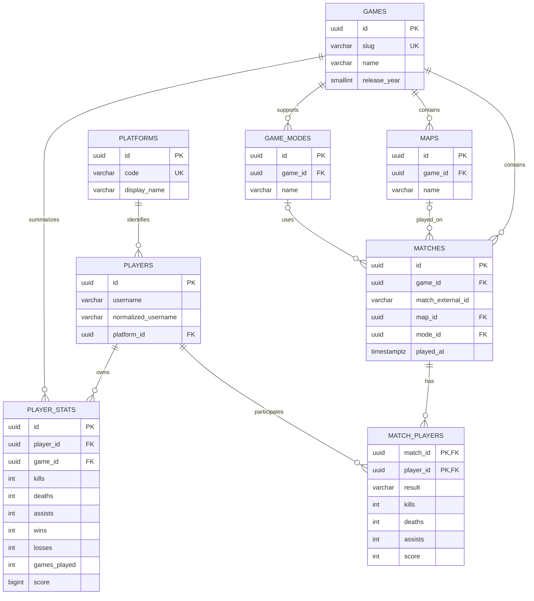

# Project Check-in 2: Normalization and Architectural Evolution

## Purpose and current starting point

This document describes the database evolution for the COD Stats application. The original migrations are retained:

- `001_initial_schema.sql`: creates `games`, `players`, `player_stats`, and the original player-centric `matches` table.
- `002_seed_games.sql`: seeds Black Ops 6 and Black Ops 7.
- `003_normalize_database.sql`: normalizes platform, map, and game-mode reference data and separates a match from each player's performance in it.

The API uses PostgreSQL. The mobile application will search for a player and display aggregate statistics and match history.

## Final schema and ER model

The final design contains eight tables:

- `games`: one row per supported Call of Duty title.
- `platforms`: canonical platform/account-network codes and display names.
- `players`: player identity and a reference to a platform.
- `player_stats`: aggregate statistics for one player in one game.
- `maps`: map names scoped to a game.
- `game_modes`: game-mode names scoped to a game.
- `matches`: game-level match metadata.
- `match_players`: each player's result and performance in a match.

The map and mode foreign keys are composite with `game_id`. This prevents a match for one Call of Duty title from referencing a map or mode belonging to another title. `match_players` has a composite primary key of `(match_id, player_id)`, so a player can appear only once in a given match.

## Normalization walkthrough

The sample facts below are illustrative and use the same values at each stage. The sample player IDs and match IDs are labels for explanation; production tables use UUIDs.

### Unnormalized form (UNF)

An early report might store several match performances in a repeating group:

| Player | Platform | Game | Year | Match performances |
|---|---|---|---:|---|
| Ghost#1234 | PC | Black Ops 6 | 2024 | (M001, Skyline, Team Deathmatch, 25 kills, 10 deaths, win); (M002, Protocol, Domination, 18 kills, 12 deaths, win) |
| Reaper#5678 | Xbox | Black Ops 6 | 2024 | (M001, Skyline, Team Deathmatch, 20 kills, 15 deaths, loss) |

The `Match performances` field contains repeating, multi-valued data. It is not atomic and cannot be reliably queried or constrained as one value.

### First Normal Form (1NF)

Expand the repeating group so each row represents one player's participation in one match. Every field now has one value.

| Player ID | Username | Platform | Game ID | Game | Year | Match ID | Map | Mode | Kills | Deaths | Result |
|---|---|---|---|---|---:|---|---|---|---:|---:|---|
| P001 | Ghost#1234 | PC | G001 | Black Ops 6 | 2024 | M001 | Skyline | Team Deathmatch | 25 | 10 | win |
| P001 | Ghost#1234 | PC | G001 | Black Ops 6 | 2024 | M002 | Protocol | Domination | 18 | 12 | win |
| P002 | Reaper#5678 | Xbox | G001 | Black Ops 6 | 2024 | M001 | Skyline | Team Deathmatch | 20 | 15 | loss |

For this flattened relation, the natural row identifier is `(player_id, game_id, match_id)). All values are atomic and each participation is represented once.

### Second Normal Form (2NF)

The 1NF relation has partial dependencies on parts of its composite key:

- `player_id -> username, platform`
- `game_id -> game name, release year`
- `(game_id, match_id) -> map, mode, match date/time`
- `(match_id, player_id) -> kills, deaths, result, score`

Separate player, game, match, and participation facts. At this stage platform, map, and mode can still be text attributes; those remaining transitive/reference dependencies are addressed in 3NF.

**PLAYERS (2NF)**

| Player ID | Username | Platform |
|---|---|---|
| P001 | Ghost#1234 | PC |
| P002 | Reaper#5678 | Xbox |

**GAMES (2NF)**

| Game ID | Game | Year |
|---|---|---:|
| G001 | Black Ops 6 | 2024 |

**MATCHES (2NF)**

| Match ID | Game ID | Map | Mode |
|---|---|---|---|
| M001 | G001 | Skyline | Team Deathmatch |
| M002 | G001 | Protocol | Domination |

**MATCH_PLAYERS (2NF)**

| Match ID | Player ID | Kills | Deaths | Result |
|---|---|---:|---:|---|
| M001 | P001 | 25 | 10 | win |
| M002 | P001 | 18 | 12 | win |
| M001 | P002 | 20 | 15 | loss |

The player-specific performance now depends on the whole participation key, not just the match or player alone.

### Third Normal Form (3NF)

Remove transitive dependencies and repeated descriptive values:

- `platform_id -> platform code, display name`; players store only `platform_id`.
- `map_id -> game_id, map name`; matches store `map_id`.
- `mode_id -> game_id, mode name`; matches store `mode_id`.
- `game_id -> slug, name, release_year`; player statistics and matches reference the game instead of repeating its descriptive attributes.

The final 3NF tables are the eight tables in the ER diagram. For aggregate statistics, `(player_id, game_id)` determines kills, deaths, assists, wins, losses, games played, and score. A unique constraint enforces one aggregate row per player/game pair.

Derived values such as K/D ratio and win percentage should be calculated from the stored counts (for example, K/D = kills / deaths with an explicit zero-death rule) rather than stored as additional independently updated facts.

## Functional dependencies

| Relation | Functional dependency / candidate key |
|---|---|
| `platforms` | `id -> code, display_name`; `code` is also unique |
| `players` | `id -> username, normalized_username, platform_id`; `(normalized_username, platform_id)` is unique |
| `games` | `id -> slug, name, release_year`; `slug` is unique |
| `player_stats` | `(player_id, game_id) -> kills, deaths, assists, wins, losses, games_played, score` |
| `maps` | `id -> game_id, name`; `(game_id, name)` is unique |
| `game_modes` | `id -> game_id, name`; `(game_id, name)` is unique |
| `matches` | `id -> game_id, match_external_id, map_id, mode_id, played_at`; non-null external IDs are unique per game |
| `match_players` | `(match_id, player_id) -> result, kills, deaths, assists, score` |

## Anomalies in the early design and how 3NF resolves them

1. **Update anomaly:** platform labels were stored on player rows. A spelling or naming correction could require updating many players. The `platforms` table stores each canonical platform once.
2. **Insertion anomaly:** adding a map or mode before a match required either duplicating its text in a match row or leaving it unrepresented. Dedicated `maps` and `game_modes` tables allow these facts to exist independently.
3. **Deletion anomaly:** deleting the last player-specific row for a match could also delete the only copy of its map, mode, and match metadata. The normalized design stores the match separately from its participants.
4. **Match duplication:** when multiple players have rows for the same external match, the old schema represented the event multiple times. The migration consolidates those rows into one `matches` row and retains each player's statistics in `match_players`.

The migration preserves existing player statistics and player-match performance. When multiple old rows share a non-null external match ID, the migration merges them only if their match-level map, mode, and played-at values agree; otherwise it raises an error instead of silently discarding conflicting facts. Rows without an external match ID remain separate because there is no safe key to prove they represent the same event.

## Integrity rules

- Primary keys identify every row.
- Foreign keys prevent orphaned players, statistics, matches, maps, modes, and participants.
- Composite foreign keys ensure a match's map and mode belong to the same game as the match.
- Unique constraints prevent duplicate game slugs, player/platform identities, per-game map/mode names, and aggregate player/game rows.
- Check constraints reject negative performance counts and invalid match results.
- The participant primary key prevents duplicate player participation rows for one match.
- Foreign-key deletion behavior is deliberate: deleting a player removes their dependent stats and participation rows; deleting a game removes its dependent catalog and match data.

## Troubleshooting reflection

The main design challenge was recognizing that a match and a player's performance in that match are different facts. The original schema placed both in one player-centric table, which was straightforward for a first API query but could not represent a shared match event cleanly. I worked backward from the functional dependencies: player identity belongs to the player, match metadata belongs to the match, and kills/deaths/result belong to the player-match relationship. I then separated repeating descriptive values such as platforms, maps, and modes into lookup tables. During migration planning, I also considered existing rows with missing external match IDs and possible conflicting match metadata. Instead of guessing that unrelated rows were the same match, the migration keeps rows without an external ID separate and stops if records with a shared external ID disagree on match-level facts. This approach prioritizes preserving information and making integrity problems visible.
